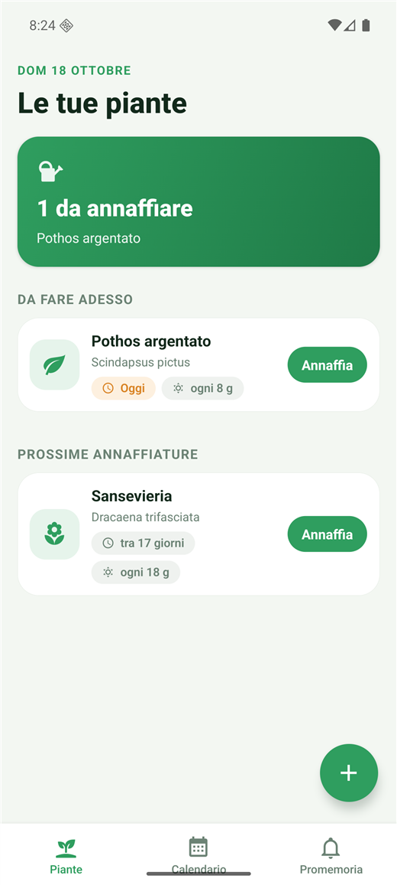
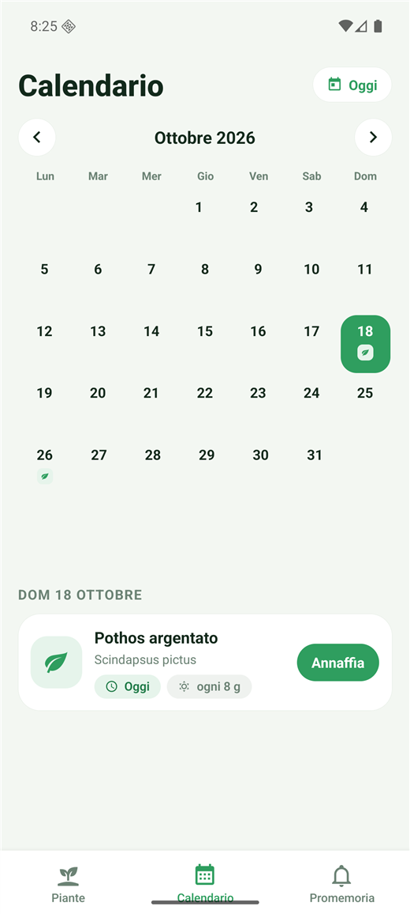
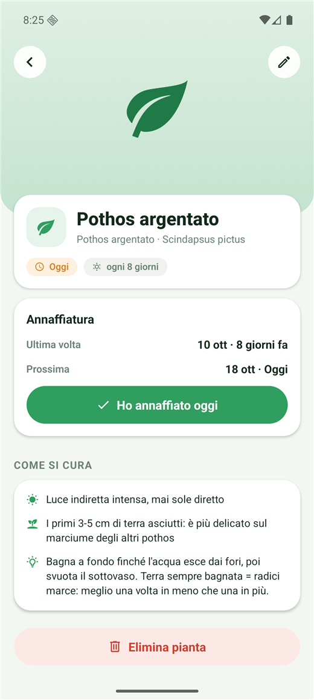
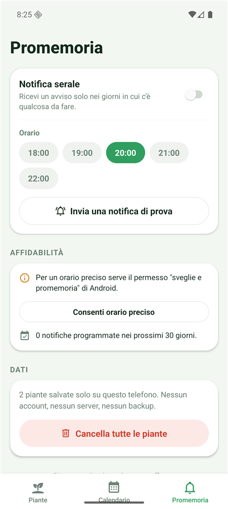
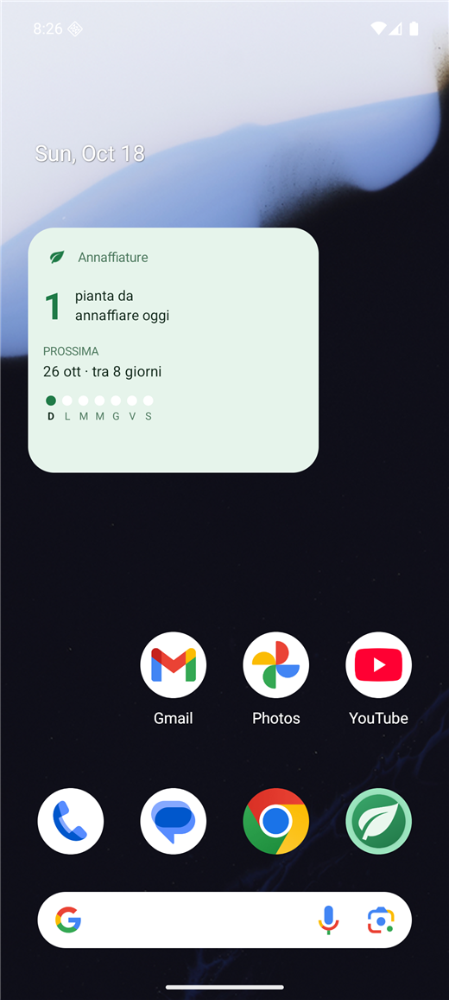

# Waterly

App Android locale per ricordare quando annaffiare le piante di casa.
Nessun account, nessun server: i dati (e le foto) restano sul telefono.

## Screenshot

| Le piante | Calendario | Dettaglio pianta |
| --- | --- | --- |
|  |  |  |

| Promemoria | Widget sulla home |
| --- | --- |
|  |  |

I widget sono due — quadrato (2×2) e orizzontale (4×2), quest'ultimo con la settimana
per esteso — e si aggiungono dall'home: pressione lunga → **Widget** → **Waterly**.
Toccando il widget si apre l'app.

## Installare l'app

1. Copia `Waterly.apk` sul telefono (cavo USB, Google Drive, Telegram…).
2. Aprilo dal telefono e consenti l'installazione da "origini sconosciute" se viene chiesto.
3. Alla prima apertura vai su **Promemoria** → accendi **Notifica serale**.

L'APK è firmato con la chiave di debug di Android: perfetto per uso personale,
ma non è pubblicabile sul Play Store.

## Uso

- **Piante** — stato di ogni pianta e pulsante "Annaffia" per segnare l'operazione di oggi.
  Il `+` in basso a destra aggiunge una pianta.
- **Calendario** — per ogni giorno vedi quali piante toccano. Tocca un giorno per l'elenco.
- **Promemoria** — orario della notifica serale (18–22), notifica di prova, azzeramento dati.

Ogni pianta nasce da un **tipo** (pothos, sansevieria, cactus…) con intervallo, luce e
indicazioni di cura già impostati; puoi comunque cambiare intervallo, icona, nome, foto e note.

## Sviluppo

```bash
npm start           # dev server (serve Expo Go sul telefono, stesso Wi-Fi)
npm run typecheck   # tsc --noEmit
npm test            # self-check della matematica sulle date
npm run apk         # ricompila l'APK di release
```

### Note sul build Android locale

Il primo build richiede Android SDK e JDK 17. Due cose da sapere:

- Il percorso di build **deve** stare fuori da `node_modules` profondi: l'SDK Android va
  in `%LOCALAPPDATA%\Android\Sdk` e `android/local.properties` punta lì.
- **Ninja dell'SDK Android (3.22.1) è troppo vecchio**: la versione 1.10.2 va in errore
  con `ninja: error: mkdir(...): No such file or directory` compilando `react-native-worklets`.
  Va sostituito con Ninja ≥ 1.12 (qui 1.13.2) in
  `%LOCALAPPDATA%\Android\Sdk\cmake\3.22.1\bin\ninja.exe`. Il backup è `ninja.exe.old`.
  Vale anche con i "percorsi lunghi" di Windows già abilitati.

`android/` è generato da `npx expo prebuild` e non va modificato a mano: le impostazioni
native stanno in `app.json`.

### Struttura

```
src/app/          schermate (Expo Router, file-based)
src/components/   UI riusabile (avatar, riga pianta, bottoni)
src/lib/          tipi, date, preset specie, store, notifiche, foto, sync widget
src/widgets/      layout dei due widget Android (2×2 e 4×2)
plugins/          withWidgetExtras.js: tocco che apre l'app + anteprima nel selettore
```

Il promemoria serale è una **notifica locale** pianificata: all'apertura dell'app si
programmano le notifiche dei prossimi 30 giorni, una per ogni giorno in cui c'è
qualcosa da fare. I giorni senza piante restano muti.
